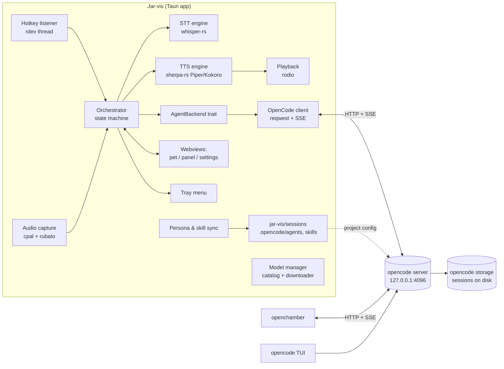
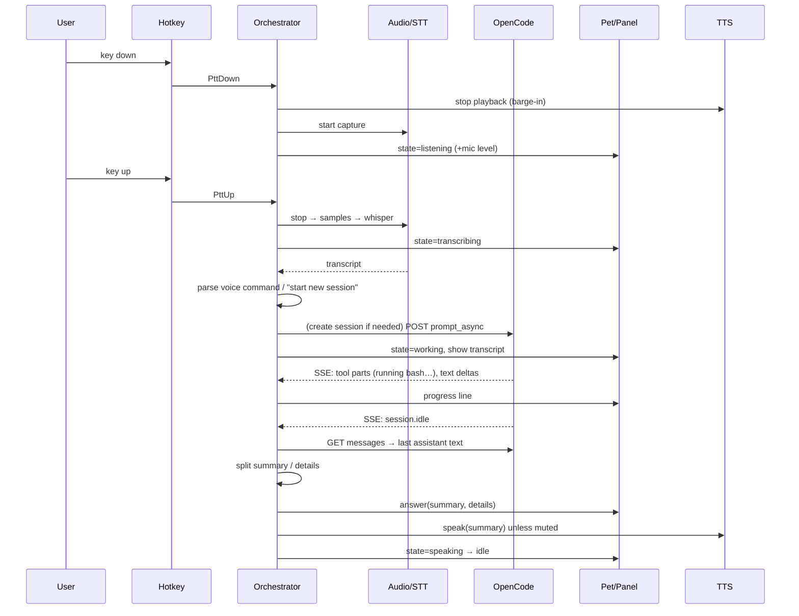

# Jar-vis — Design & Implementation Plan

> Audience: the engineer/agent implementing this project. Follow the milestones in order (§12).
> Anything marked **VERIFY** is an external API detail that you must confirm against the installed
> version (for opencode: the OpenAPI spec at `http://127.0.0.1:4096/doc`) before relying on it.

---

## 0. One-paragraph summary

Jar-vis is a small desktop "pet" (a transparent, always-on-top window) that acts as a voice front-end
for **opencode**. You hold a single configurable key, speak, and release. Jar-vis records the audio, transcribes it
locally with **Whisper** (whisper.cpp), and sends the text as a prompt to an **opencode session** through
opencode's HTTP server. While opencode works, the pet animates and shows what it is doing. When the turn finishes,
the pet shows a short answer in a minimizable text panel and, unless muted, speaks it with a local **Piper**
voice. Sessions are normal opencode sessions in a dedicated working directory (`jar-vis/sessions`), so you can open
the same session in openchamber or the opencode TUI and continue there. You can also point Jar-vis at an existing session in
any other project. The app is built with **Tauri 2 (Rust core + small TypeScript UI)** for macOS and Windows.

---

## 1. Decisions already made with the user

| Topic | Decision |
|---|---|
| Stack | Tauri 2: Rust core with a TypeScript UI (Svelte 5 + Vite). |
| Agent backend | opencode is mandatory. Codex is optional and comes in a later phase behind the same trait. |
| Session scope | Jar-vis uses its own workspace (`jar-vis/sessions`) by default. **Attach mode** lets the user point it at an existing session in any project and detach later. |
| Push-to-talk | A **single key** (no combo), hold to talk. It is configurable in Settings with a "press a key to record it" control. |
| Language | **English only**. Use English-only Whisper models (`*.en`) and English voices. |
| Autostart | No autostart with the OS. The user launches it manually, and it stays idle for days. |
| Models | STT and TTS model choice is configurable, with a downloader. The default is small, and the user can switch to bigger models without friction. |
| Audio | There is a mute checkbox. When muted, the TTS model is not loaded at all. |
| Text output | The panel can always be minimized. |

---

## 2. Requirements (analysed)

### Functional
1. **F1 Push-to-talk.** Holding the configured key starts recording, and releasing it stops recording. Key autorepeat is ignored.
2. **F2 Local STT.** Whisper runs in-process. The model is configurable (tiny.en … large-v3-turbo).
3. **F3 Session routing.**
   - If there is no current session, or the transcript starts with "start new session" (and variants, §7.5), create a new session and send the remainder (if any).
   - Otherwise, send to the current session.
   - The current session survives app restarts (persisted).
4. **F4 Agent execution** happens in opencode. Jar-vis never runs tools itself.
5. **F5 Progress feedback.** The pet shows the states idle, listening, transcribing, thinking or working (with the current tool name), needs-permission, speaking, error, and offline.
6. **F6 Short answer.** The agent is instructed to start with a short spoken summary. Jar-vis speaks only the summary, and the panel shows summary + details.
7. **F7 TTS** uses Piper voices locally. It has a mute toggle in the panel, the tray and the config.
8. **F8 Text panel** can be shown, minimized or expanded. It renders markdown and keeps the history of the current session's exchanges.
9. **F9 Continuity.** Sessions are real opencode sessions and can be opened in openchamber or the opencode TUI. Jar-vis offers "Open in openchamber", "Open in opencode TUI" and "Copy session ID".
10. **F10 Personalities/agents/skills** are authored in `jar-vis/assistant/…` and made available to opencode automatically (§9).
11. **F11 Attach mode.** The user can pick any existing opencode session (any project) and talk to it, then detach to go back to the Jar-vis workspace.
12. **F12 Permissions.** When opencode asks for permission (bash/edit/…), the pet shows it with Allow once / Always / Deny buttons. The user can also answer by voice ("yes", "no", "always").
13. **F13 Voice control commands** are handled locally: "start new session …", "stop"/"cancel" (abort the running turn), "mute"/"unmute", and "repeat" (replay the last answer).

### Non-functional
- **NF1** macOS (Apple Silicon + Intel) and Windows 10/11 x64.
- **NF2 Lightweight.** The idle footprint (excluding models) is ≤ ~120 MB. Models load lazily and can be unloaded when idle (§10).
- **NF3 Easy install.** There is one installer per OS (.dmg / .msi or NSIS .exe) and a first-run wizard. The only external prerequisite is opencode installed and logged in.
- **NF4 Robustness.** Jar-vis survives opencode restarts (SSE reconnect), network/model errors, and the machine sleeping for days.
- **NF5 Privacy.** Audio never leaves the machine. Only the transcript is sent to opencode.

---

## 3. Architecture



**Key idea: one shared opencode server.** Jar-vis and openchamber should both use the same `opencode serve`
instance on `127.0.0.1:4096`, so a session Jar-vis is driving updates live in openchamber and vice versa.
- openchamber's documented startup order is: reuse its own, use external `OPENCODE_HOST` if set, **auto-detect a server on port 4096**, else start its own.
- Jar-vis's startup is: connect to the configured URL (default `http://127.0.0.1:4096`). If nobody is listening and `opencode.autostart = true`, spawn `opencode serve --hostname 127.0.0.1 --port 4096` itself. openchamber started later will then auto-detect it.
- If openchamber's own managed server is on another port, the user either sets Jar-vis's `opencode.url` to it or starts openchamber with `OPENCODE_HOST=http://127.0.0.1:4096 OPENCODE_SKIP_START=true`. Document this in the README.
- Even with two separate servers, sessions are persisted on disk by opencode, so they still show up after a reload. Only the live streaming would be missing.

**Where sessions "live".** opencode does not store sessions inside the project folder. It stores them in its own
data dir, keyed by project and directory. `jar-vis/sessions` is the **working directory** of Jar-vis sessions. That is
what makes them appear under that project in openchamber, and what gives them their own agents and skills config. Explain this
in the README so the user is not surprised that `sessions/` contains no transcripts.

---

## 4. Tech stack

The versions are the latest stable at implementation time. Pin them in `Cargo.toml` and `package.json`.

| Concern | Choice | Notes |
|---|---|---|
| App shell | **Tauri 2** (`tauri` with `tray-icon`, `macos-private-api` features) | Transparent frameless windows and tray. Small footprint (system WebView). |
| UI | **Svelte 5 + Vite + TypeScript** | There are three tiny entry pages: `pet.html`, `panel.html` and `settings.html`. Markdown uses `marked` + `dompurify`. |
| Async runtime | `tokio` | |
| Global key | **`rdev`** from `https://github.com/rustdesk-org/rdev` (the fork Handy uses) | It gives raw key down/up for *any single key*, including left/right modifiers. **Fallback:** `handy-keys` (supports press/release, modifier-only hotkeys, a key-recording listener, and optional blocking). |
| Audio in | `cpal` | Any device and format, converted to f32 mono. |
| Resampling | `rubato` | To 16 kHz for Whisper. |
| Audio out | `rodio` | Interruptible `Sink` for barge-in. |
| STT | **`whisper-rs`** (whisper.cpp bindings) | `metal` feature on macOS. CPU on Windows by default (`vulkan` is an optional cargo feature). It needs CMake + libclang to build. The reference alternative is `transcribe-cpp` (used by Handy). |
| TTS | **`sherpa-rs`** (sherpa-onnx bindings, prebuilt libs via its default `download-binaries` feature) | Runs **Piper (VITS) voices** and also **Kokoro** as the "bigger, better" option. Fallback: the Piper CLI as a sidecar process (§7.6). |
| HTTP/SSE | `reqwest` (json, stream) + `eventsource-stream` (or `reqwest-eventsource`) | Write a thin own client rather than depending on an early-stage SDK crate. |
| Config | `serde` + `toml` | Human-editable `config.toml`. |
| Paths | `directories` | OS config, data and log dirs. |
| Persona parsing | `serde_yaml` + a simple frontmatter splitter | |
| Logging | `tracing` + `tracing-appender` (daily file rotation) | |
| Tauri plugins | `single-instance`, `opener`, `dialog`, `log` (optional), `macos-permissions` | |
| Downloads | `reqwest` streaming + `sha2` verification + `tar`/`bzip2` for sherpa voice archives | |

Reference implementation worth reading: **Handy** (`github.com/cjpais/Handy`). It is a Tauri push-to-talk Whisper app for macOS, Windows and Linux,
and uses cpal, rdev (rustdesk fork), rubato, whisper.cpp, the macOS permissions plugin and a model downloader. Copy patterns, not code wholesale.
Check its license.

---

## 5. Repository layout

```
jar-vis/
├─ README.md                      # install, first run, openchamber pairing, troubleshooting
├─ docs/PLAN.md                   # this file
├─ .gitignore                     # models/, sessions/* (except .gitkeep, README.md), target/, node_modules/, dist/
├─ assistant/
│  ├─ app/                        # the Tauri application
│  │  ├─ package.json
│  │  ├─ vite.config.ts           # multi-page: pet, panel, settings
│  │  ├─ pet.html  panel.html  settings.html
│  │  ├─ src/
│  │  │  ├─ pet/                  # Pet.svelte, skin loader, animations
│  │  │  ├─ panel/                # Panel.svelte (summary, details, history, permission prompt)
│  │  │  ├─ settings/             # Settings.svelte + tabs
│  │  │  └─ lib/                  # ipc.ts (typed invoke/listen wrappers), types.ts
│  │  └─ src-tauri/
│  │     ├─ Cargo.toml  build.rs  tauri.conf.json
│  │     ├─ capabilities/default.json
│  │     ├─ Info.plist            # NSMicrophoneUsageDescription, LSUIElement
│  │     ├─ resources/
│  │     │  ├─ models.catalog.json
│  │     │  └─ defaults/          # bundled default agents/, skills/, pets/ (copied to home on first run if missing)
│  │     └─ src/
│  │        ├─ main.rs  lib.rs    # setup, windows, tray, plugin registration
│  │        ├─ config.rs          # load/save/validate config.toml, defaults, hot-reload hooks
│  │        ├─ state.rs           # persisted runtime state (state.json)
│  │        ├─ orchestrator.rs    # the state machine (§6)
│  │        ├─ hotkey.rs
│  │        ├─ audio/{capture.rs, playback.rs, resample.rs, level.rs}
│  │        ├─ stt/{mod.rs, whisper.rs, filter.rs}
│  │        ├─ tts/{mod.rs, sherpa.rs, sanitize.rs}
│  │        ├─ backend/{mod.rs, opencode/{mod.rs, client.rs, events.rs, server.rs, types.rs}}
│  │        ├─ commands.rs        # voice command parsing (§7.5)
│  │        ├─ reply.rs           # summary/details split (§7.5)
│  │        ├─ personas.rs        # agent/skill sync (§9)
│  │        ├─ models/{catalog.rs, download.rs, manager.rs}
│  │        ├─ launch.rs          # open in openchamber / TUI, find opencode binary
│  │        └─ ipc.rs             # #[tauri::command]s and event names
│  ├─ agents/                     # personalities, source of truth (§9)
│  │  ├─ _voice-rules.md
│  │  └─ jarvis.md
│  ├─ skills/                     # opencode skills (one folder per skill with SKILL.md)
│  │  └─ quick-note/SKILL.md      # example skill
│  └─ pets/
│     └─ default/pet.json + assets
├─ sessions/                      # opencode working dir for Jar-vis sessions
│  ├─ .gitkeep
│  ├─ AGENTS.md                   # generated
│  └─ .opencode/                  # generated: agents/, skills/ (do not edit, see §9)
└─ models/                        # downloaded STT/TTS models (gitignored)
   ├─ stt/
   └─ tts/
```

**Jar-vis home.** The app needs to know the `jar-vis/` folder.
- Store it in the OS config file as `home`.
- In dev (`tauri dev`), default it to the repo root, detected by walking up from the executable/cwd until `assistant/agents` exists.
- In an installed build, the first-run wizard asks for it with a folder picker. The default is `~/jar-vis`, created with the bundled defaults if it is empty.

---

## 6. Core flow & state machine

### 6.1 Happy path



### 6.2 States

`Offline | Idle | Listening | Transcribing | Sending | Working{tool?} | AwaitingPermission{req} | Speaking | Error{msg}`
- The UI-only sub-state `Sleeping` is shown when the app has been Idle for more than `ui.sleep_after_minutes`.

### 6.3 Transitions (implement as a single `tokio` task owning the state, fed by an `mpsc` of `Event`s)

| From | Event | To / action |
|---|---|---|
| any except Offline | `PttDown` | Stop TTS if Speaking. Start capture. Go to **Listening** and remember the previous state. |
| Listening | `PttUp` | Stop capture. If duration < `stt.min_seconds` or RMS < threshold, discard and restore the previous state. Otherwise go to **Transcribing**. |
| Listening | other key pressed during hold (only if `hotkey.cancel_on_chord`) | Discard the recording and restore the previous state (lets the user use the modifier normally). |
| Transcribing | `Transcript(text)` | Run the hallucination filter. Run `commands::parse` (§7.5). For a command, execute it. For a prompt: if the target session is busy, push it to a local queue (show "queued"). Else **Sending**. |
| AwaitingPermission | `Transcript("yes"/"allow"/"always"/"no"…)` | Reply to the permission request and go back to **Working**. |
| Sending | prompt accepted | **Working** |
| Working | `ToolRunning{tool,title}` | Update the progress line. |
| Working | `PermissionAsked{…}` | Go to **AwaitingPermission**. Show buttons. Speak "I need your permission to …" (short, unless muted). |
| Working | `SessionIdle` | Fetch the answer and split it. Show it in the panel. If not muted, go to **Speaking**, else **Idle**. Then flush the local queue. |
| Working | `SessionError{msg}` | **Error** (shown for 6 s, then Idle). |
| Speaking | playback finished | **Idle** |
| any | backend disconnected | **Offline**. Retry with backoff (1 s → 30 s). On reconnect, resync (§7.4.6). |

Recording is allowed while Working. That prompt is queued and sent after `session.idle`. This avoids interfering with a running turn.

---

## 7. Components

### 7.1 Hotkey (`hotkey.rs`)
- Run `rdev::listen` on a dedicated OS thread (not the Tauri main thread). Forward `KeyPress`/`KeyRelease` for the configured key to the orchestrator through a channel.
- Track `is_down` so autorepeat key-down events are ignored.
- Config stores the key as the rdev `Key` debug name (e.g. `"ControlRight"`, `"MetaRight"`, `"F13"`, `"Pause"`), plus `cancel_on_chord`.
- **Recording a new key** (Settings → "Press a key…"): the next key-press seen by the same listener is returned to the UI instead of being matched.
- **Default key.** The first-run wizard asks the user to press one. Suggested defaults: **Windows `ControlRight`**, **macOS `MetaRight`** (Right ⌘).
  - **Do not default to Right Alt / AltGr or Right Option.** The user is in Germany, and on German layouts those keys type `@ € { } [ ] \ |`.
- `listen` mode does not suppress the key, so it still reaches the focused app. That is harmless for a lone modifier or a spare F-key. Suppression (rdev `grab` / `handy-keys` blocking) is optional (`hotkey.suppress = false`) and must never be applied to modifiers.
- **macOS** needs the **Accessibility** permission (and possibly Input Monitoring) for global key events. Check it at startup with `tauri-plugin-macos-permissions`. If it is missing, show a pet bubble with a button that opens System Settings.
  - Note: unsigned or ad-hoc-signed rebuilds reset the TCC permission. Recommend signing dev builds with one stable self-signed certificate.
- **Windows:** the low-level hook needs no permission. Note in the README that keys are not seen while an elevated (admin) window has focus, unless Jar-vis also runs elevated.
- If `rdev` misbehaves on a platform, swap the implementation behind the `HotkeyListener` trait for `handy-keys` (`HotkeyManager` + `KeyboardListener` for recording).

### 7.2 Audio capture (`audio/capture.rs`)
- Open the cpal input stream **on key-down** and close it on key-up. Do not keep the mic open: the macOS mic indicator would stay on and it wastes power.
- Device: `audio.input_device` (name) or the system default. Settings lists the devices.
- Callback: convert to f32 mono and push into a `Vec<f32>` behind a mutex. Compute RMS every ~50 ms and emit `mic-level` to the pet for the listening animation.
- On stop: resample to 16 kHz mono with rubato. Enforce `stt.max_seconds` (default 120). Return the samples.
- macOS: `NSMicrophoneUsageDescription` in Info.plist. Check or request the mic permission on first run.

### 7.3 STT (`stt/`)
```rust
pub trait SttEngine: Send + Sync {
    fn load(&mut self, model_path: &Path) -> Result<()>;
    fn is_loaded(&self) -> bool;
    fn unload(&mut self);
    fn transcribe(&mut self, pcm_16k_mono: &[f32]) -> Result<String>; // call via spawn_blocking
}
```
- `WhisperEngine` (whisper-rs):
  - `WhisperContext::new_with_params` and `FullParams` with `SamplingStrategy::Greedy { best_of: 1 }`.
  - `language = "en"`, `translate = false`, `no_context = true`, `n_threads = min(physical_cores, 8)`.
  - `initial_prompt = stt.vocabulary` (a configurable string like `"opencode, openchamber, Tauri, Rust, TypeScript, Kubernetes"`), which improves recognition of technical terms.
  - Suppress non-speech tokens. Concatenate segment texts and trim.
- **Lazy load** the model on the first PTT, or eagerly at startup if `stt.preload = true` (default true). Unload after `stt.unload_after_idle_minutes` (0 = never; default 0, since the user accepts the model living in memory).
- **Hallucination filter** (`filter.rs`): drop results that are empty or match a normalized blocklist, e.g. `you`, `thank you`, `thanks for watching`, `[blank_audio]`, `(silence)`, `[music]`.
- **Switching model** in Settings unloads the old model and loads the new one in the background. Show progress on the pet.

### 7.4 Agent backend (`backend/`)

```rust
#[async_trait]
pub trait AgentBackend: Send + Sync {
    async fn connect(&self) -> Result<BackendInfo>;                 // health + version
    async fn list_projects(&self) -> Result<Vec<ProjectRef>>;
    async fn list_sessions(&self, dir: &Path) -> Result<Vec<SessionSummary>>;
    async fn create_session(&self, dir: &Path) -> Result<SessionRef>;
    async fn get_session(&self, s: &SessionRef) -> Result<Option<SessionSummary>>;
    async fn send_prompt(&self, s: &SessionRef, text: &str, opts: &PromptOpts) -> Result<()>;
    async fn abort(&self, s: &SessionRef) -> Result<()>;
    async fn last_assistant_text(&self, s: &SessionRef) -> Result<String>;
    async fn reply_permission(&self, s: &SessionRef, req_id: &str, reply: PermissionReply) -> Result<()>;
    fn subscribe(&self) -> broadcast::Receiver<BackendEvent>;      // normalized events
}
pub struct SessionRef { pub id: String, pub directory: PathBuf }
pub struct PromptOpts { pub agent: Option<String>, pub model: Option<ModelRef>, pub system: Option<String> }
pub enum BackendEvent {
    Connected, Disconnected,
    SessionBusy { session: String },
    ToolRunning { session: String, tool: String, title: Option<String> },
    TextDelta { session: String, text: String },
    PermissionAsked { session: String, id: String, kind: String, title: String, patterns: Vec<String> },
    SessionIdle { session: String },
    SessionError { session: String, message: String },
}
```

#### 7.4.1 OpenCode server discovery & spawn (`opencode/server.rs`)
1. `GET {url}/global/health` (**VERIFY** the path in `/doc`; fallback: `GET {url}/path`). Success means connected.
2. On failure, if `opencode.autostart`: resolve the opencode binary and spawn `opencode serve --hostname 127.0.0.1 --port <port>` with cwd = Jar-vis home.
   - Poll health for up to 15 s.
   - Windows: use `CREATE_NO_WINDOW` so no console flashes.
   - Pipe stdout/stderr to the Jar-vis log.
3. **Binary resolution** (`launch.rs`). On macOS, GUI apps launched from Finder do **not** inherit the shell `PATH`. Check in this order:
   1. `opencode.binary` from config
   2. `which::which("opencode")`
   3. common locations: `~/.opencode/bin`, `/opt/homebrew/bin`, `/usr/local/bin`, `~/.bun/bin`, the npm global prefix, `%APPDATA%\npm\opencode.cmd`, `%USERPROFILE%\.opencode\bin`
   4. macOS last resort: run `$SHELL -lic 'command -v opencode'`
   
   If it is not found, the pet goes Offline with the bubble "opencode not found — set its path in Settings" and a link to opencode.ai.
4. Spawned server lifetime: `opencode.stop_on_exit` (default **false**, because openchamber may have attached to it). If true, kill the child on app exit.
5. Auth: if `opencode.password` is set, send HTTP basic auth with username `opencode.username` (default `opencode`). That matches `OPENCODE_SERVER_PASSWORD`.

#### 7.4.2 Directory scoping
- Every request carries the target directory, either as the query param `?directory=<abs path>` or the header `x-opencode-directory`. The server creates or reuses an instance per directory.
- Jar-vis workspace mode uses directory `<home>/sessions`. Attach mode uses the attached session's `directory`.

#### 7.4.3 Endpoints used (**VERIFY** each against `/doc` of the installed version and adapt)

| Purpose | Call |
|---|---|
| List projects | `GET /project` (worktree paths) |
| List sessions | `GET /session?directory=…` |
| Create session | `POST /session` body `{}`. Leave the title empty so opencode auto-generates one. |
| Get session | `GET /session/:id` (404 means it is gone, so create a new one) |
| Send prompt (non-blocking) | `POST /session/:id/prompt_async` body `{ parts:[{type:"text",text}], agent?, model?:{providerID,modelID}, system? }` → 204 |
| Messages | `GET /session/:id/message` → `[{info, parts}]`. Take the **last** message with `info.role=="assistant"` and join its `parts` of `type=="text"` (skip `synthetic`/reasoning). |
| Abort | `POST /session/:id/abort` |
| Session status (resync) | `GET /session/status` (**VERIFY**). Otherwise check the last assistant message's `time.completed`. |
| Permission reply | Newer versions: `POST /permission/:requestID/reply` `{reply:"once"\|"always"\|"reject"}`. Older versions: `POST /session/:id/permissions/:permissionID` `{response:…}`. **VERIFY** which exists and implement that one. |
| Events | `GET /global/event` (all directories; each event wraps `{directory, payload}`). Fallback: `GET /event?directory=…`. **VERIFY** the envelope shape. |

#### 7.4.4 Event normalization (`opencode/events.rs`)
Parse SSE JSON as `{type, properties}`. Map the following and ignore everything else (unknown types must not error):
- `session.status` (busy) → `SessionBusy`
- `message.part.updated` where `part.type=="tool"` and `part.state.status=="running"` → `ToolRunning{tool: part.tool, title: part.state.title}`
- `message.part.updated` where `part.type=="text"` → `TextDelta` (optional live text in the panel)
- `permission.asked` (older: `permission.updated`) → `PermissionAsked`
- `session.idle` → `SessionIdle`
- `session.error` → `SessionError`
- `server.connected` → `Connected`

Filter by the session IDs Jar-vis cares about (the current session plus any queued ones).

#### 7.4.5 Sending a prompt
- **Workspace mode:** `agent = <active personality's opencode agent name>` (e.g. `jarvis`), `model` = personality override or none, `system = voice rules` (§7.5).
- **Attach mode:** `agent` = none (the session keeps its agent) unless `attach.override_agent` is set. `system = voice rules` still applies, so replies stay speakable.
  - **VERIFY** that `system` is appended to and does not replace the agent prompt. If it replaces it, prepend the voice rules as a short instruction inside the text part instead: `"[voice mode: …]\n\n<transcript>"`.

#### 7.4.6 Reconnect & resync
- The SSE loop reconnects with exponential backoff.
- After reconnecting while in Working: query the session status (or the last message completion). If the turn finished, process it as `SessionIdle`.
- After the machine wakes from sleep: a health check on wake (or on every PTT if more than 5 min have passed since the last successful call).

#### 7.4.7 "Open elsewhere" (`launch.rs`)
- **Copy session ID** → clipboard.
- **Open in opencode TUI** → open a terminal in the session directory running `opencode --session <id>` (**VERIFY** the flag with `opencode --help`; consider `opencode attach <url>` so it shares the same server).
  - Windows: `wt.exe -d <dir> opencode …`, falling back to `cmd /c start cmd /k …`.
  - macOS: `osascript` to tell Terminal to run `cd <dir> && opencode …`.
- **Open in openchamber**:
  - If `openchamber.url` is set (web/PWA, e.g. `http://localhost:3000`), open it. **VERIFY** whether openchamber supports a deep link to a session; if so, build it.
  - Else, if `openchamber.app_path` is set, launch the desktop app (macOS `open -a OpenChamber`).
  - Always also copy the session ID.

### 7.5 Voice commands & reply format (`commands.rs`, `reply.rs`)

**Normalization:** lowercase, strip punctuation, collapse whitespace, strip an optional leading wake word (`"jarvis"`, from config).

**Commands** (all phrase lists configurable in `[commands]`):
- **New session:** a regex like `^(start|open|begin|create)( a)? new (session|chat|conversation)\b` → create a new session.
  - Strip the phrase; if remaining text exists, send it as the first prompt. Otherwise speak "New session started."
  - Also leave attach mode (the new session is in the Jar-vis workspace).
- `stop` / `cancel` / `abort` (whole utterance only) → abort the current turn.
- `mute` / `unmute` / `be quiet`
- `repeat` / `say that again` → replay the last summary.
- In AwaitingPermission: `yes|allow|ok|do it` → once, `always` → always, `no|deny|don't` → reject.
- Anything else → a prompt.

**Voice rules** (`assistant/agents/_voice-rules.md`). These are embedded into every personality and also sent as `system` in attach mode:

> Your reply will be read aloud. Begin with one or two short, plain sentences (no markdown, no code, no lists, no URLs) that directly answer or report the outcome. If more detail is useful, add a line containing only `---` and put the details (markdown allowed) below it. Keep the spoken part under 40 words.

**Splitting (`reply.rs`):**
- `summary` = the text before the first line that is exactly `---`.
- `details` = the text after it.
- If there is no separator: summary = the first 2 sentences (max `tts.max_spoken_chars`, default 400), details = the full text.

**TTS sanitizing (`tts/sanitize.rs`):**
- Strip markdown syntax.
- Replace code blocks with "I put the code in the panel."
- Replace URLs with "a link".
- Expand a few symbols (`&` → "and").
- Truncate to `max_spoken_chars` at a sentence boundary.

### 7.6 TTS (`tts/`)
```rust
pub trait TtsEngine: Send + Sync {
    fn load(&mut self, voice: &VoiceSpec) -> Result<()>;
    fn unload(&mut self);
    fn synthesize(&mut self, text: &str, speed: f32) -> Result<(Vec<f32>, u32 /*sample_rate*/)>;
}
```
- `SherpaEngine` uses sherpa-rs:
  - `VitsTts` for Piper voices (needs `model.onnx`, `tokens.txt` and the `espeak-ng-data/` dir that ship in each sherpa voice archive).
  - `KokoroTts` for Kokoro.
  - **VERIFY** the exact struct and config names in the sherpa-rs docs and examples.
- **Low latency:** split the summary into sentences. Synthesize sentence 1, start playback in a rodio `Sink`, and synthesize the rest while it plays.
- **Barge-in:** `PttDown` calls `sink.stop()` and cancels pending synthesis.
- **Mute:** when `audio.tts_enabled = false`, the model is never loaded, and it is unloaded if it was loaded. Unmuting loads it lazily.
- Unload after `tts.unload_after_idle_minutes` (default 30).
- **Fallback if sherpa-rs is problematic on a platform:** the Piper CLI as a sidecar.
  - Download `piper` release binaries into `models/tts/bin`.
  - Run `piper --model X.onnx --output_raw` with the text on stdin, and read raw 16-bit PCM from stdout.
  - Keep that behind the same trait.

### 7.7 UI

#### Windows (in `tauri.conf.json`, created hidden and shown from Rust as needed)

| Label | Properties |
|---|---|
| `pet` | 150×150, `transparent`, `decorations:false`, `alwaysOnTop`, `skipTaskbar`, `resizable:false`, `shadow:false`, `focus:false`, `visibleOnAllWorkspaces` (mac). Draggable (`data-tauri-drag-region` on the pet body or `startDragging()` on mousedown). Position persisted. |
| `panel` | ~380×300, frameless, `alwaysOnTop`, `skipTaskbar`, `focus:false`, hidden by default. Positioned next to the pet (left or right depending on screen edge, recomputed when the pet moves). |
| `settings` | Normal decorated window, 760×560, hidden until opened. |

- macOS:
  - `app.macOSPrivateApi: true` (needed for transparency).
  - Use `ActivationPolicy::Accessory`, so there is no Dock icon and the app lives in the menu bar.
  - **Do not steal focus** when the pet or panel updates. Test this on both OSs, because a panel that grabs focus while the user types in their IDE is a showstopper. If `show()` activates the window on Windows, set `WS_EX_NOACTIVATE`. On macOS consider `tauri-nspanel`.
- Single instance: `tauri-plugin-single-instance`. A second launch just shows the pet.

#### Pet (`src/pet`)
- Renders the current state's animation from the active **pet skin**.
- **Skin format** (`assistant/pets/<name>/pet.json`):
  ```json
  { "name": "default", "size": 128,
    "states": {
      "idle":         { "src": "idle.png", "frames": 8, "fps": 6, "loop": true },
      "sleeping":     { "src": "sleep.png", "frames": 4, "fps": 2, "loop": true },
      "listening":    { "src": "listen.png", "frames": 6, "fps": 10, "loop": true, "micLevel": true },
      "transcribing": { "src": "think.png", "frames": 6, "fps": 8, "loop": true },
      "working":      { "src": "work.png", "frames": 8, "fps": 10, "loop": true },
      "permission":   { "src": "alert.png", "frames": 2, "fps": 3, "loop": true },
      "speaking":     { "src": "talk.png", "frames": 4, "fps": 10, "loop": true },
      "error":        { "src": "error.png", "frames": 1 },
      "offline":      { "src": "offline.png", "frames": 1 }
    } }
  ```
  - `src` is either a horizontal sprite sheet (`frames` > 1) or an animated `gif`/`webp`/`apng` (`frames` omitted).
  - Missing states fall back to `idle`.
  - Assets are served to the webview via Tauri's asset protocol (`convertFileSrc`), with the asset scope limited to `<home>/assistant/pets`.
- **The MVP ships a code-drawn default pet** (SVG + CSS animations: a round blob with eyes, so no art assets are needed). Its states are blink, pulse with mic level, spinning "thinking" dots, bouncing while working, an "!" for permission, and a mouth for speaking. Custom skins come later.
- Small overlays:
  - a tiny status line under the pet while working (tool name, e.g. "bash: npm test")
  - a mute badge
  - an "attached: <project>" badge in attach mode
- Interactions:
  - left-click toggles the panel
  - drag moves the pet
  - right-click opens a context menu (same items as the tray)
  - double-click replays the last answer

#### Panel (`src/panel`)
- Header:
  - session title and mode (workspace / attached project)
  - 🔊 mute checkbox
  - "open in…" menu (openchamber / TUI / copy ID)
  - minimize button
- Body: the **current answer summary** prominently, with "Details ▸" expandable (markdown). Above it, the user's transcript in muted text.
- History: scroll up to see earlier exchanges from this Jar-vis run (kept in memory, max 50).
- Permission prompt card: the description, then the buttons **Allow once / Always / Deny**.
- Live progress line while Working (tool calls; optional streaming text if `ui.stream_text`).
- Behaviour:
  - `ui.panel_auto_show` (default true) shows the panel on a new answer.
  - `ui.panel_auto_hide_seconds` (default 0 = never) hides it automatically.
  - Minimizing hides the window. The pet keeps working.

#### Settings (`src/settings`). Tabs:
1. **General** — Jar-vis home folder, push-to-talk key ("Press a key…" recorder), cancel-on-chord, sleep timeout, panel behaviour.
2. **Voice input** — input device, STT model dropdown (from the catalog, showing size, RAM estimate and installed state, plus a Download button with progress), vocabulary prompt, preload/unload, a "Test: hold key and speak" feedback area.
3. **Voice output** — enable TTS, voice dropdown with download and a **Preview** button, speed, max spoken chars, unload timeout.
4. **OpenCode** — server URL, autostart, stop on exit, binary path, username/password, default personality, model override (populated from `GET /config/providers`, **VERIFY**), and a connection test button.
5. **Personality & pet** — choose the active personality (the list comes from `assistant/agents`), pet skin, and a "Re-sync agents & skills" button.
6. **Sessions** — current session (ID, title, open/copy buttons), "New session", and **Attach…** (a list of projects → sessions with title and updated time, searchable). Also "Detach".
7. **Advanced** — log level, open the logs folder, open the config file, reset to defaults.

Saving writes `config.toml` and applies changes live: re-register the hotkey, swap models, reconnect the backend.

#### Tray menu
- Status line (disabled item)
- Show/Hide pet
- Show/Hide panel
- Mute ✓
- New session
- Stop current task
- Attach to session… / Detach
- Open current session in ▸ (openchamber / opencode TUI / Copy ID)
- Personality ▸ (radio list)
- Settings…
- Quit

### 7.8 IPC contract (`ipc.rs` ↔ `src/lib/ipc.ts`)
**Rust → UI events:**
- `state` `{state, detail?}`
- `mic-level` `{rms}`
- `transcript` `{text}`
- `progress` `{text}`
- `answer` `{summary, details, sessionId, sessionTitle}`
- `permission` `{id, kind, title, patterns}`
- `session` `{id, title, directory, mode}`
- `config-changed`
- `download-progress` `{modelId, bytes, total}`
- `toast` `{level, text}`

**UI → Rust commands:**
- `get_config`, `save_config(cfg)`, `set_muted(bool)`
- `new_session`, `abort`, `reply_permission(id, reply)`
- `list_projects`, `list_sessions(dir)`, `attach(sessionId, dir)`, `detach`
- `open_session_in(target)`, `copy_session_id`
- `list_models`, `download_model(id)`, `delete_model(id)`, `preview_voice(id)`
- `start_hotkey_capture` (resolves with the key name)
- `list_input_devices`, `list_personalities`, `list_pets`, `resync_personas`
- `toggle_panel`, `replay_last`

Define the TS types once in `src/lib/types.ts`. They must mirror the Rust `serde` structs (`#[serde(rename_all = "camelCase")]`).

---

## 8. Configuration

**Location:** `<os config dir>/jarvis/config.toml`
- Windows: `%APPDATA%\jarvis\config.toml`
- macOS: `~/Library/Application Support/jarvis/config.toml`

Validate it on load. Invalid values fall back to defaults with a toast.

```toml
home = "C:/projects/jar-vis"           # Jar-vis home (repo folder)

[hotkey]
key = "ControlRight"                   # rdev key name; set by the wizard
cancel_on_chord = true
suppress = false

[audio]
input_device = ""                      # "" = system default
tts_enabled = true                     # the mute checkbox

[stt]
model = "base.en-q5_1"                 # id from models.catalog.json
preload = true
unload_after_idle_minutes = 0          # 0 = keep loaded
min_seconds = 0.35
max_seconds = 120
vocabulary = "opencode, openchamber, Tauri, Rust, TypeScript"

[tts]
voice = "piper-en_US-lessac-medium"    # id from catalog
speed = 1.0
max_spoken_chars = 400
unload_after_idle_minutes = 30

[opencode]
url = "http://127.0.0.1:4096"
autostart = true
stop_on_exit = false
binary = ""                            # "" = auto-detect
username = "opencode"
password = ""
workspace_dir = ""                     # "" = <home>/sessions

[persona]
active = "jarvis"                      # file stem in assistant/agents
pet = "default"

[attach]
override_agent = ""                    # "" = keep the session's agent

[openchamber]
url = ""                               # e.g. http://localhost:3000
app_path = ""

[commands]
wake_word = "jarvis"
new_session = ["start new session", "start a new session", "new session", "new chat", "new conversation"]
stop = ["stop", "cancel", "abort"]
mute = ["mute", "be quiet"]
unmute = ["unmute"]
repeat = ["repeat", "say that again"]

[ui]
panel_auto_show = true
panel_auto_hide_seconds = 0
stream_text = false
sleep_after_minutes = 10

[models]
dir = ""                               # "" = <home>/models

[log]
level = "info"
```

**Runtime state** goes in `<os data dir>/jarvis/state.json`:
- `currentSession` `{id, directory}`
- `attached` (bool)
- `petPosition`, `panelVisible`, `lastAnswer`

Write it atomically (write to temp, then rename).

---

## 9. Personalities, agents & skills

**Source of truth** lives under `jar-vis/assistant/`:
- `agents/<name>.md` is a personality: an opencode agent definition plus Jar-vis-specific metadata.
- `agents/_voice-rules.md` holds the shared voice rules, appended to every personality body.
- `skills/<skill-name>/SKILL.md` follows the opencode skill format (`name` and `description` frontmatter, name = folder name, lowercase-hyphenated).

**Personality file example (`assistant/agents/jarvis.md`):**
```markdown
---
description: Jarvis — calm, concise voice assistant for a software engineer
mode: primary
# model: anthropic/claude-sonnet-4-5   # optional; a fast model gives snappier voice replies
temperature: 0.3
permission:
  edit: ask
  webfetch: allow
  external_directory: ask
  bash:
    "*": ask
    "ls *": allow
    "cat *": allow
    "git status*": allow
    "git log*": allow
jarvis:                      # Jar-vis-only block, stripped before writing for opencode
  display_name: Jarvis
  voice: piper-en_US-lessac-medium
  speed: 1.0
  pet: default
---
You are Jarvis, a friendly desktop assistant living on the user's screen. The user is a software engineer.
Be direct and practical. You can use tools, but prefer short answers…
```

**Sync step (`personas.rs`)** runs at startup, on "Re-sync", and when a file in `assistant/agents|skills` changes (use the `notify` crate with a debounce; optional):
1. For each `assistant/agents/*.md` (excluding names starting with `_`):
   - parse the frontmatter
   - remove the `jarvis:` key
   - append `_voice-rules.md` to the body
   - write `sessions/.opencode/agents/<name>.md`
   - prefix the file with a comment `<!-- GENERATED by Jar-vis from assistant/agents/<name>.md — edit the source -->`, placed **after** the frontmatter so YAML parsing is unaffected
2. Mirror `assistant/skills/**` → `sessions/.opencode/skills/**` (copy; delete stale ones). Copy rather than symlink, because Windows symlinks need Developer Mode.
3. Generate `sessions/AGENTS.md`: a short context file ("This folder is the Jar-vis workspace. Notes the user asks to save go in `notes/`…"). It is generated only if missing, so the user can edit it.
4. opencode loads project agents and skills from `.opencode/` walking up to the git worktree root. Placing them in `sessions/.opencode/` means they apply **only** to Jar-vis sessions and not to development of the Jar-vis app itself (which happens at the repo root).
   - **VERIFY** whether a running opencode instance picks up changed agent files without a restart. If not, call the instance-dispose endpoint for that directory (**VERIFY** in `/doc`, e.g. `POST /instance/dispose`) after syncing.

**Switching personality** (tray or settings): this changes `persona.active`. The next prompt uses `agent=<name>`, plus that personality's TTS voice and pet skin. The current session continues; opencode allows changing the agent per message.

**Shipped defaults:**
- `jarvis.md`
- one playful example personality, `pixel.md` (a cheerful pixel-cat persona with a different voice)
- one example skill, `quick-note` ("save a note to `notes/YYYY-MM-DD.md` in the workspace")

---

## 10. Models & memory budget

**`resources/models.catalog.json`** entries: `{id, kind: "stt"|"tts", engine, display, url, sha256, size_mb, ram_mb_est, files[], license}`.
- Fill in `sha256` and `size_mb` by downloading each file once while building the catalog.
- **STT** files come from `https://huggingface.co/ggerganov/whisper.cpp/resolve/main/ggml-<name>.bin`.
- **TTS** archives come from the sherpa-onnx `tts-models` GitHub release (`vits-piper-en_US-*.tar.bz2`, `kokoro-*.tar.bz2`). **VERIFY** the exact filenames on the release page.

| Id (catalog) | Kind | Disk ≈ | RAM ≈ | Notes |
|---|---|---|---|---|
| `tiny.en-q5_1` | STT | 31 MB | ~100 MB | Fastest, weakest |
| **`base.en-q5_1`** | STT | 57 MB | ~180 MB | **Default.** Good for short commands |
| `small.en-q5_1` | STT | 181 MB | ~400 MB | Recommended upgrade |
| `medium.en-q5_0` | STT | ~515 MB | ~900 MB | |
| `large-v3-turbo-q5_0` | STT | ~550 MB | ~1 GB | Multilingual, best quality |
| `piper-en_US-amy-low` | TTS | ~60 MB | ~90 MB | Fast |
| **`piper-en_US-lessac-medium`** | TTS | ~65 MB | ~120 MB | **Default** |
| `piper-en_GB-alan-medium` | TTS | ~65 MB | ~120 MB | British voice |
| `piper-en_US-ryan-high` | TTS | ~120 MB | ~200 MB | Better, slower |
| `kokoro-en` (int8 if available) | TTS | ~100–330 MB | ~300–500 MB | Best quality option |

Treat the numbers as estimates and show them in Settings.

**Expected footprint:**
- The app itself is ~50–120 MB (Rust core is a few MB; most is the system WebView: WebView2 on Windows, WKWebView on macOS).
- With the defaults loaded, the total is ~350–450 MB.
- Muted with STT unload enabled, it can idle at ~100 MB.
- Keep only `pet` alive by default. Create `settings` lazily and **destroy it on close**, to save WebView memory.

**Download manager:**
- Stream to `*.part`, verify sha256, then extract and rename atomically.
- Show progress in Settings and on the pet. Downloads can be cancelled.
- The first run downloads the two defaults (~120 MB) automatically after asking.

---

## 11. Platform, packaging & install

**Dev prerequisites** (put in README):
- Rust stable, Node 20+, and the Tauri 2 prerequisites.
- **CMake** (for whisper.cpp).
- **LLVM/libclang** (bindgen; on Windows set `LIBCLANG_PATH`).
- macOS: Xcode Command Line Tools.
- Windows: MSVC Build Tools + WebView2 (preinstalled on Win 11).

**Commands:** `cd assistant/app && npm i && npm run tauri dev`. Release: `npm run tauri build`.

**CI:** GitHub Actions with `tauri-apps/tauri-action`.
- Matrix: `macos-14` (aarch64), `macos-13` (x86_64) or a universal build, `windows-latest`.
- Outputs: `.dmg` and `.msi`/NSIS `.exe` attached to a GitHub Release.
- whisper-rs features per target: `metal` on macOS, none on Windows.

**Signing:**
- Unsigned is acceptable for personal use.
- macOS: the README explains right-click → Open the first time, and re-granting Accessibility after updates. Optional: Developer ID signing + notarization later.
- Windows: SmartScreen "More info → Run anyway".

**First-run wizard** (shown in the `settings` window in wizard mode):
1. Choose the Jar-vis home folder.
2. Check opencode: find the binary, start or connect to the server, and show the version. If no provider is configured, tell the user to run `opencode auth login`.
3. Permissions: microphone (both OSs), Accessibility (macOS).
4. Choose the push-to-talk key (press a key).
5. Download the default models (with progress), with an option to choose others.
6. Test: "Hold your key and say *hello*". This shows the transcript and plays the spoken reply.
7. Done. The pet appears in the bottom-right corner.

**openchamber pairing note** for the README: run openchamber against the same server
(`OPENCODE_HOST=http://127.0.0.1:4096 OPENCODE_SKIP_START=true`, or just start Jar-vis first so openchamber auto-detects port 4096). Then add `jar-vis/sessions` (or `jar-vis`) as a project in openchamber to see Jar-vis sessions.
- **VERIFY** how openchamber groups sessions whose directory is a subfolder of a git repo.
- If `sessions/` doesn't show as a clean separate project, run `git init` in `sessions/`, add it to the parent `.gitignore`, and make one empty commit, so it becomes its own opencode project.

---

## 12. Milestones (implement in order; each ends with its acceptance check)

**M0 — Scaffold**
- Tauri 2 + Svelte + Vite multi-page app in `assistant/app`, the repo layout from §5, `.gitignore`, config load/save with defaults, `tracing` to a file, single-instance, tray with Quit.
- ✅ The app starts on macOS and Windows with a tray icon. `config.toml` is created with defaults.

**M1 — OpenCode client (headless first)**
- Server discovery/spawn, the binary resolver, the REST client, SSE event normalization, and session create/continue with persisted `currentSession`.
- Add a debug-only command `jarvis_send_text(text)` (and a hidden text box in the panel in dev builds) so the whole loop can be tested without audio.
- ✅ Typing "what's 2+2" in the dev box creates a session in `<home>/sessions`. The answer comes back. The same session is visible in openchamber and continues there. "start new session" creates a new one. Killing and restarting opencode mid-turn recovers.

**M2 — Personas sync**
- `personas.rs`, the default `jarvis.md` + `_voice-rules.md`, the example skill, summary/details splitting.
- ✅ Prompts use `agent=jarvis`. The reply starts with a short summary and `---`. The skill is listed in opencode for that workspace.

**M3 — Push-to-talk + STT**
- rdev listener, key recording, cpal capture, resampling, whisper-rs, the hallucination filter, a minimal model download for the default STT model.
- ✅ Holding the key and speaking sends the transcript to the session. Releasing within 0.3 s is ignored. Pressing another key while holding cancels. Works with the IDE focused (key not swallowed, no focus stealing).

**M4 — Pet & panel UI**
- Code-drawn default pet with all states, the panel (summary, details, history, progress, permission card), dragging, persisted position, right-click menu.
- ✅ All states are visible during a real turn. The panel minimizes and restores. Permission requests can be approved from the panel. No focus stealing on either OS.

**M5 — TTS**
- sherpa-rs Piper engine, sentence-chunked playback, barge-in, mute (unloads the model), voice preview.
- ✅ The summary is spoken within ~1 s of the answer arriving (on the default voice). Pressing the key while it speaks stops it immediately. Muting stops the speech and frees the memory (check in Task Manager / Activity Monitor).

**M6 — Settings & model manager**
- All tabs from §7.7, the catalog, download/verify/delete, live apply, the first-run wizard.
- ✅ Switching `base.en` → `small.en` from Settings downloads and swaps it without restarting. A fresh install goes from zero to a first spoken answer through the wizard only.

**M7 — Voice commands & attach mode**
- Command parser, voice permission replies, attach picker (projects → sessions), detach, "open in" actions.
- ✅ "stop" aborts the running turn. "yes" approves a pending permission. Attaching to a session in another project and asking "what did we just change?" answers in that session's context. That session's openchamber view shows the voice messages.

**M8 — Hardening & packaging**
- Reconnect after sleep, idle unload timers, log rotation, error toasts, CI release builds, README.
- ✅ Left running for 3 days idle, it still responds on the first press, and memory is stable (no growth after 50 turns). Installers are produced by CI for both OSs.

**M9 (optional) — Codex backend**
- Implement `AgentBackend` for Codex via `codex app-server` (JSON-RPC over stdio: thread start/resume, turn start, item/turn notifications, approval requests). **VERIFY** the current protocol in the Codex repo docs.
- Add a `[backend] kind = "opencode" | "codex"` config and a backend picker in the tray.
- Codex threads continue in the Codex CLI via `codex resume <id>`.

**M10 (later) — Custom pets**
- Skin loader for sprite sheets and animated images (§7.7), and a pet picker.
- Optional: speaking mouth synced to TTS amplitude.

---

## 13. Testing

**Unit tests (Rust):**
- `commands::parse` (many phrasings and punctuation from Whisper, e.g. "Start a new session. Check my email" → NewSession + "check my email")
- `reply::split`
- `sanitize`
- hallucination filter
- config defaults/migration
- persona frontmatter strip/merge
- catalog parsing

**Integration tests:**
- An opencode client test against a real `opencode serve` (ignored by default; run with `cargo test -- --ignored`), using a cheap model.
- An SSE parser test with recorded event fixtures (save real event JSON lines into `tests/fixtures/`).

**Audio:** a `tests/fixtures/hello.wav` → whisper transcription contains "hello".

**Manual checklist per OS** (in `docs/TESTING.md`):
- focus stealing
- hotkey with each candidate key
- sleep/wake
- mic permission denied path
- opencode not installed path
- openchamber live view

---

## 14. Risks & mitigations

| Risk | Mitigation |
|---|---|
| opencode API drift (endpoint names and event shapes change between versions) | All calls are in `backend/opencode/*`. Parse events tolerantly. Log unknown events at debug level. Check the server version at connect and warn if outside the tested range. |
| rdev issues on newer macOS | The hotkey sits behind a trait, with `handy-keys` as the drop-in alternative. Use the rustdesk fork (proven in Handy). |
| whisper-rs build pain on Windows (libclang/CMake) | Document the prerequisites. CI builds the installers, so the end user never compiles. Alternative engine: `transcribe-cpp`. |
| sherpa-rs prebuilt libs mismatch | The Piper CLI sidecar fallback is behind the same TTS trait. |
| Panel/pet steals focus while typing | Explicit acceptance test in M3/M4. Use non-activating windows. |
| Agent replies too long for voice | Voice rules plus forced splitting/truncation. The full text is always in the panel. |
| Two opencode servers (openchamber started its own) | Health/version shown in Settings, plus the README pairing instructions. Sessions still sync via disk. |
| Whisper hallucinations on silence | RMS gate, min duration, blocklist filter. |
| AltGr conflict on German keyboard | Never default to Right Alt or Right Option. Allow chord-cancel. |

---

## 15. Out of scope for v1
- Autostart with the OS (explicitly not wanted).
- Wake-word / always-listening mode.
- Languages other than English.
- Streaming STT while speaking.
- Mobile.
- Remote (non-localhost) opencode servers. They might work via the URL setting, but they are untested.
