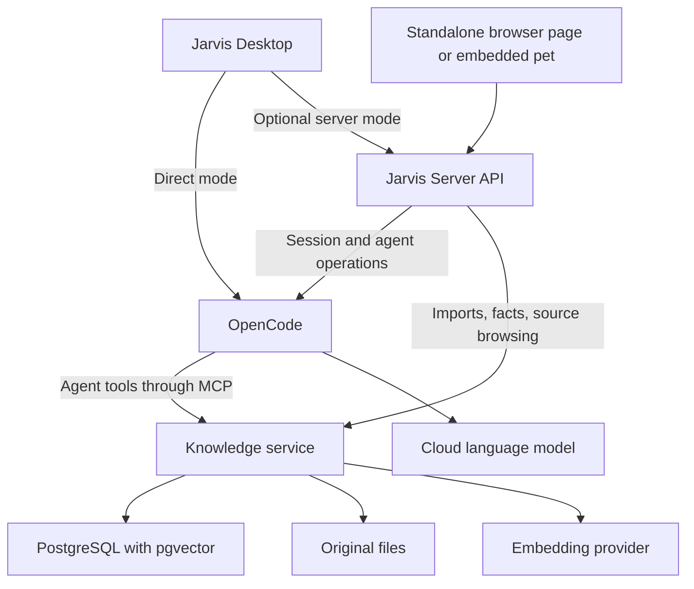

# Jarvis: optional server, personal memory, and Agentic RAG

Status: implementation in progress; M1 and server/browser text flow implemented, M0 automated baseline/contracts recorded, read-only MCP integration verified. Remaining milestone requirements are not complete.
Date: 2026-10-18.

### Implementation progress — 2026-10-18

- Added independently runnable `services/knowledge` (Rust/Axum/SQLx), PostgreSQL/pgvector development Compose file, versioned migration, authenticated management API, and CLI inspector. Desktop startup/configuration are unchanged; Jarvis Server remains optional and unimplemented.
- M1 verified against real PostgreSQL: Markdown and two-page fictional rulebook PDF imports, originals, headings/pages, English full-text ranking, exact metadata filters, section reads, duplicate uploads, atomic replacement, failed replacement preservation, interrupted-job recovery, and source deletion including durable file cleanup.
- Added early M4 read-only MCP `search_knowledge`/`read_section` via the official Rust SDK at authenticated `/mcp`. Live test through the existing OpenCode 2.0.26 installation and its existing OpenAI connection completed actual search/read calls and returned the expected trade rule with the correct section UUID. No new OpenCode installation, global config edit, embedding credential, or Jarvis Server was needed.
- OpenCode v2 tool exposure requires `codemode: false` for this direct-tool, deny-general-execution test agent. The opt-in smoke test uses a temporary location/session/config and cleans them up.
- Verification: Desktop frontend check (zero errors/warnings), 79 Desktop Rust unit tests without speech engines, knowledge unit/CLI/auth tests, real PostgreSQL/MCP integration test, strict Clippy, and documented CLI demo. Interactive desktop/voice checks remain manual and unverified in this session; M0 is not fully closed.
- Development fixtures are synthetic, not Dima's personal information. Provider for testing: the existing OpenCode/OpenAI account. Home-server provider is undecided. M2 embeddings/hybrid/fixed-pipeline comparison, M3 personal memory, the rest of M4, M5–M8 remain outstanding. No claim of real-mini-PC resource validation or completed browser/server work.
- Start/inspect instructions: `services/knowledge/README.md`. Ownership/API contracts and baseline limitations: `docs/AGENTIC_RAG_CONTRACTS.md`.
- Local run convention: Docker Compose runs only PostgreSQL/pgvector; knowledge service, Jarvis Server, and Jarvis Web run locally using normal Cargo/npm commands. Each component uses an ignored `.env` with a committed `.env.example`; no PowerShell launcher or shell exports are required.

### Server/browser implementation — 2026-10-18

- Browser settings follow-up: compact four-icon header (ten latest sessions, new, settings, minimize); Connection/Backend/Speech settings; per-browser backend URL and per-tab secret; exact-origin CORS and authenticated streaming fetch for direct connections. Shared model/agent defaults persist in ignored `.data/settings.json`; defaults apply to new sessions, with explicit idle-current-session updates. `jarvis-home-assistant` is the default personality, with a study companion option and legacy session-agent alias. Selected and live-tested the existing `openai/gpt-6-luna` model; Desktop remains unchanged. Speech controls are reserved/disabled, not implemented voice features. Added persistence/catalog/session-update/CORS/recent-session regression coverage and verified the browser settings flow.

- Added runnable `services/server` and `assistant/web`, using Node.js 22.16+ with no npm dependencies. Both run with `npm start` and local ignored `.env` files. Existing Desktop code/startup stays independent; no new OpenCode installation or global configuration changes.
- Gateway: owner login/HttpOnly cookie, exact-origin checks, isolated persistent OpenCode workspace and dedicated bounded knowledge agent, session creation/listing, prompt/stop, permission arbitration, token deltas plus reconnect snapshots, and allowlisted authenticated knowledge management proxy. Knowledge can be absent/offline without disabling ordinary chat. Generated workspace config holds only the knowledge token; cloud credentials remain in OpenCode.
- Browser: floating SVG pet, expandable responsive session panel, typed chat, live text/tool states, source citation links, document uploads, import progress, source inspection, original downloads and deletion. Plain static assets, no CDN/framework/build step. Same-site iframe loader uses explicit framing allowlist; unrelated-site authentication/pairing remains M7.
- Verification: seven gateway tests (authentication/origins/logout, session isolation, concurrent prompt/permission arbitration, optional knowledge, filtered events/reconnect, transcript normalization, and knowledge proxy/error isolation), web asset/proxy/frame-policy test, and opt-in live browser-proxy→gateway→existing OpenCode/OpenAI→knowledge MCP test. Live test imported a disposable synthetic source, verified search/read tool completion, correct citation, streamed deltas/snapshots, original download and source reads, then removed only its test source/session. Browser UI verified login, real typed RAG question, completed tool traces, source inspection, and transcript recovery after reload. Static browser assets total approximately 34 KB uncompressed; no mini-PC performance claim.
- M5/M6 text flow is runnable, not the entire milestone checklist: Desktop server transport, server-owned scheduling, personal-fact UI depend on further work and are not advertised as implemented. M2/M3 embeddings/memory, full M4 evaluation, cross-site M7 pairing, and M8 deployment/resource/restore verification remain outstanding.

## 1. Goal and confirmed requirements

Build this incrementally so Dima can understand and inspect retrieval, memory, and agent decisions. The finished system extends OpenCode with personal knowledge and provides desktop and browser interfaces.

- Jarvis Desktop MUST continue working without Jarvis Server. No server account, server installation, database, or knowledge service is required for existing desktop functionality.
- Jarvis Web requires Jarvis Server.
- Desktop retains direct access to OpenCode, including an explicitly configured remote OpenCode instance. Connecting Desktop through Jarvis Server is an optional additional mode.
- Shared knowledge is optional. Missing knowledge must not prevent ordinary chat or current desktop capabilities.
- Initial language-model generation uses a cloud provider through OpenCode.
- Target server: a 15 W mini PC, 32 GB total RAM, approximately 10 GB available for this project. Treat that as a ceiling, not permission to consume it all.
- Browser UI should resemble Desktop: floating pet and expandable session panel. Support a standalone page and embedding in websites Dima controls.
- Some duplicated desktop/server orchestration is acceptable. Desktop independence takes precedence over extracting a perfectly shared backend.

## 2. Current repository state

There is currently no separate Jarvis Server. The Tauri desktop process manages voice, application state, scheduling, and communication with OpenCode. Its Svelte UI invokes Tauri commands. Browser development previews use a mock backend, not a real server connection.

Relevant existing files:

- `assistant/app/src-tauri/src/orchestrator.rs`: desktop turn and event handling, currently tied to Tauri and local devices.
- `assistant/app/src-tauri/src/backend/`: existing agent-backend abstraction and OpenCode implementation.
- `assistant/app/src-tauri/src/backend/opencode/server.rs`: local discovery/start and explicit remote OpenCode URL support.
- `assistant/app/src/lib/ipc.ts`: Tauri-specific frontend transport.
- `assistant/app/src/lib/mock.ts`: browser preview backend.
- `assistant/skills/quick-note/SKILL.md`: current file-based note capture; not yet a structured memory service.

OpenCode itself runs a service. That service is distinct from the optional Jarvis Server proposed here. Desktop independence means independence from Jarvis Server, not independence from its agent backend or cloud model connectivity.

## 3. Mental model

### Basic RAG

Saving: source file -> extracted text -> sections/chunks -> searchable index.

Answering: question -> fixed retrieval operation -> selected source text -> cloud model -> answer with citations.

An embedding is a numeric representation used to search by meaning. It does not replace source text, train the answer model, or prove that a result is correct. Combine semantic results with keyword search and metadata filters.

### Agentic RAG

OpenCode's agent chooses when to search, which sections to read, whether to search again, and when the evidence is sufficient. One agent is enough. Put limits on retrieval calls and context size, and report missing evidence rather than searching forever.

### Memory

Personal facts are explicit, editable records with provenance and history. Documents are versioned sources with retrievable sections. Conversation history stays in OpenCode; selected user-authorized facts become memory. Do not silently treat every conversation statement or model inference as a durable fact.

## 4. Optional deployment modes

| Mode | Connection | Capabilities |
|---|---|---|
| Desktop standalone | Desktop -> OpenCode -> cloud model | Existing chat, local voice, pet, permissions, scheduling; no Jarvis Server or knowledge requirement |
| Desktop with knowledge | Desktop -> OpenCode -> knowledge tools through MCP | Standalone behavior plus RAG/memory when that OpenCode instance has knowledge tools configured |
| Desktop with server | Desktop -> Jarvis Server -> OpenCode | Shared server-managed sessions and optional knowledge; desktop audio/hotkeys remain client-local initially |
| Web standalone page or embedded widget | Browser -> Jarvis Server -> OpenCode | Server-managed sessions and optional knowledge; browser microphone support comes later |

In direct mode, the MCP connection belongs to OpenCode, not Desktop. OpenCode can access a knowledge service on the same machine or a configured remote service. Jarvis Server need not be installed for this path.

Server failure must not prevent Desktop from launching in direct mode. Offer an explicit switch to direct mode; never silently replay a pending message against another backend or assume sessions automatically migrate between OpenCode instances.

## 5. Architecture and ownership



These are logical responsibilities, not a requirement for a separate container per box. Initially the knowledge service can expose its management HTTP API and MCP interface from one process. It must be runnable separately from Jarvis Server. Use one durable ingestion queue/worker in that service rather than adding a message broker.

### Why Jarvis Server calls the knowledge service directly

Ordinary app operations do not need a language model or an agent:

- Upload a rulebook and enqueue text extraction/indexing.
- Display extraction progress, failures, and indexed sections.
- List, inspect, correct, export, or delete saved facts.
- Browse a citation's original source and page.
- Run a search preview so Dima can inspect results before asking for an answer.

MCP exposes selected knowledge operations as tools to an agent. It is an interface, not the search algorithm or database. The management API and MCP adapter call the same underlying knowledge functions and enforce the same ownership rules.

Keyword search, file management, and fact CRUD can work without an AI model. Semantic indexing/search requires an embedding model, but not OpenCode or a chat model. Natural-language answers still require the language model.

## 6. Technical direction

### Database and files

Use PostgreSQL with pgvector for structured facts, document metadata, extracted chunks, embeddings, and full-text search. Keep original uploads on server disk with stable identifiers and checksums. Keep OpenCode sessions in OpenCode's storage; avoid copying them into a second authoritative conversation database.

Start without a separate vector database, Redis, a graph database, or a second agent framework. Add a component only when a measured requirement justifies it.

### Runtime and code sharing

Proposed default: small Rust services using the existing project's language and HTTP client experience, plus Svelte/TypeScript clients. Confirm maintenance and document-extraction library suitability during the first milestone. Avoid pinning dependency versions until implementation checks compatibility.

- Keep Desktop's existing local execution path intact.
- Extract transport-neutral OpenCode client/types where this is straightforward; do not move device or window behavior into the server.
- Create a frontend client interface with Tauri, remote HTTP/event-stream, and development-mock adapters.
- Share useful view components and schemas. Desktop windows and browser floating layout can have separate shells.
- It is acceptable for Desktop and Server to have separate orchestration implementations, provided their observable session/permission behavior is checked for consistency.

### Cloud models and resource constraints

Use the existing OpenCode cloud provider for answer generation. Proposed initial embedding choice: a cloud embedding API behind a replaceable adapter. This avoids running an additional model on the constrained CPU and makes early retrieval easier to measure.

This choice sends document chunks and search queries to the embedding provider. Retrieved passages and questions are also sent to the answer provider. Storage at home does not make processing fully local. Document this clearly before importing personal material. Local embeddings can be added later after a CPU/RAM benchmark; a local generative model is outside the initial scope.

Store embedding model identity, dimensions, and index version. Changing embedding spaces requires rebuilding the relevant index; do not mix incompatible embeddings.

Limit extraction concurrency to one initially, cap upload size and retrieved context, and bound database connection pools. Start with plain text, Markdown, and text-based PDFs. Identify scanned PDFs as unsupported until OCR is added. Measure idle and peak memory, import duration, retrieval latency, and provider cost before expanding the corpus.

## 7. Knowledge data and tool contracts

Suggested records:

- `documents`: owner, title, source, file checksum/path, edition, game, document type, version, import state.
- `chunks`: document/version ID, text, heading, page range where available, order, embedding model/version, vector, full-text index.
- `facts`: owner, subject/key when applicable, user wording/value, active/superseded state, source reference, timestamps.
- `fact_events`: create/correct/forget history with the initiating user/session reference; honor deletion policy rather than retaining forgotten content indefinitely.
- `ingestion_jobs`: persisted status, attempts, errors, progress, and document/index generation.

Suggested agent tools:

```text
search_knowledge(query, filters, limit)
read_section(section_id, surrounding_sections)
list_facts(filters)
remember_fact(text, source_reference)
update_fact(fact_id, replacement_text, source_reference)
forget_fact(fact_id)
```

Search results return stable source/section IDs, readable excerpts, version/page metadata, and retrieval diagnostics. The model can cite only sources actually returned or read. Search diagnostics are relevance signals, not calibrated probabilities.

An explicit user request to remember, correct, or forget authorizes the corresponding memory operation. For ambiguous facts, ask a focused question instead of inventing a preference. Do not require another confirmation for every explicit save. Use structured fact lookup for known profile keys; use search for less structured notes. Current active facts take precedence over superseded entries.

Imports must be idempotent, report extraction failures, and retain the last successful searchable version until replacement indexing succeeds. Deleting a source removes its searchable chunks and embeddings. Treat retrieved document contents as evidence, never as instructions granting tool access.

## 8. Lightweight browser client and embedding

Deliver one browser UI in two shells:

1. A standalone Jarvis page served by Jarvis Server.
2. A small embed loader that mounts the pet and expandable panel on a host website.

Proposed embedding approach: a tiny loader creates a fixed-position, cross-origin iframe hosted by Jarvis Server. Render the pet and session panel inside that iframe; resize its bounds as the panel opens/closes so it does not intercept unrelated page interactions. Reuse Svelte view components where practical, lazy-load panel code, and use a small sprite/CSS pet rather than a large animation runtime.

The iframe provides a useful isolation boundary for personal conversations. A Shadow DOM component is an alternative for trusted host pages, but style encapsulation alone is not a security boundary. Keep authentication material out of embed attributes, URLs, and host-page messages. Use an explicit sign-in/pairing flow in the Jarvis origin, short-lived scoped client sessions, and test behavior when third-party cookies are blocked. If necessary, use a top-level pairing window and a narrowly scoped session held inside the iframe. Do not assume cross-site cookie authentication works everywhere.

Requirements:

- Floating pet, open/close session panel, session selection, typed chat, streamed status, stop, permission decisions, and citations.
- No full-page application framework or local model download in the browser. Proposed initial budget: loader <= 20 KB gzip; initial widget JS/CSS <= 200 KB gzip excluding pet images; report actual production sizes and revise only with evidence.
- Respect reduced-motion preferences, keyboard access, focus restoration, and narrow viewports.
- Define host origin allowlists, iframe embedding policy, strict `postMessage` origin/schema checks, and authenticated API access. CORS/origin checks do not replace authentication.
- Never expose OpenCode credentials, unrestricted OpenCode endpoints, or cloud API keys to the host website.
- Text-first MVP. Later add a push-to-talk button and optional server speech processing, accounting for microphone permission, HTTPS/secure-context requirements, iframe permissions, and audio playback interaction requirements. Desktop retains its current local voice engines.
- A widget must work without access to host-page content. Reading the current webpage is a separate explicit integration with a defined data-sharing boundary.

Embedding is supported on sites Dima can edit and whose policies permit the widget. A browser extension can later inject it into other websites, subject to browser/site restrictions. Do not promise universal injection, global desktop hotkeys, or unrestricted background microphone access from a web widget.

## 9. Jarvis Server behavior

Provide a versioned, authenticated API for capabilities, session operations, event streaming, permission replies, uploads, import status, source reading, and memory management. Advertise unavailable knowledge/voice features explicitly so clients can disable only affected controls.

The server owns agent turn state and schedules for server-mode sessions; clients reconnect to that state. Desktop owns its existing schedules in direct mode. Do not run a schedule twice or migrate schedules implicitly. Closing a browser does not cancel server work. Multiple clients viewing one session receive consistent events and permission resolution; define concurrent-message queuing and event reconnection/resynchronization.

Limit the personal-assistant agent to knowledge tools initially. Server-side coding tools, if enabled later, act on the server workspace, not the laptop filesystem. Preserve approval handling and do not accidentally give an embedded widget broader privileges than the authenticated user session.

Serve behind HTTPS for normal remote/browser deployment and bind private dependencies to loopback/private container networks. Start with one owner and private LAN/VPN reachability. Internet exposure and multi-user sharing are separate work. Back up both database and original files and verify a restore.

## 10. Implementation milestones and acceptance criteria

Each milestone should include a short explanation/demo of what was added, inspectable intermediate output, and a focused verification. Stages are deliberately small enough to learn from. Dima authorized implementation after this plan was created.

### M0: Record contracts and preserve standalone behavior

- Record a desktop smoke baseline: launch, direct OpenCode connection, typed/voice turn, permissions, session switching, and schedules.
- Define client modes, capabilities, knowledge tool schemas, and service ownership.
- Verify the actual installed OpenCode v2 MCP/API behavior before coding adapters; current generic web docs may describe a different version.

Done when the connection modes and contract fixtures are documented and Desktop works with no Jarvis Server configured or running.

### M1: Build inspectable retrieval without an agent

- Create the independently runnable knowledge service, database migration, and tiny CLI/development inspector.
- Import one text/Markdown source, then one text-based rulebook PDF; display extracted sections and provenance.
- Implement keyword search and source reading. Establish known-answer questions and missing-answer cases.

Done when Dima can trace question -> retrieved text -> original source without OpenCode or Jarvis Server running.

### M2: Add embeddings and basic RAG

- Add the embedding adapter, vector storage, filters, and hybrid ranking; compare against keyword-only results.
- Use a development command with a fixed retrieval pipeline and one cloud-model answer call; it does not run an agent loop.
- Show retrieved context, source links, model identity, latency, and approximate provider usage.

Done when rule questions receive supported citations, unrelated questions report insufficient evidence, and game/edition filters prevent using the wrong rulebook. Explain the contribution and limitations of embeddings using actual results.

### M3: Add explicit personal memory

- Implement fact save/list/update/forget with provenance and persistence across processes/sessions.
- Add five user-provided food preferences and correct one.
- Define deletion/export behavior, duplicate handling, and conflict handling.

Done when the correction changes active retrieval, forgotten content is excluded from active storage/indexes according to policy, and ordinary chat does not automatically become personal memory. Explain that backups/OpenCode transcripts require separate retention handling.

### M4: Connect OpenCode and enable Agentic RAG

- Expose knowledge functions through MCP and configure a dedicated Jarvis knowledge agent.
- Keep simple retrieval and fact management working independently of the harness.
- Add bounded follow-up retrieval and visible tool traces; compare the same question with M2's fixed pipeline.
- Connect the existing Desktop directly to the configured OpenCode instance without introducing Jarvis Server.

Done when Desktop recalls preferences in a new session, answers a question requiring two sources, reports a missing rule honestly, and keeps ordinary chat working when knowledge is unavailable. Show which searches the agent chose and why the retrieved evidence supports its answer.

### M5: Add optional Jarvis Server

- Implement the minimal headless session gateway and event/state contracts, reusing neutral components where useful.
- Add authenticated knowledge management routes and optional Desktop remote transport.
- Add server-owned scheduling only with explicit ownership and persistence; keep direct Desktop scheduling unchanged.
- Provide deployment configuration with separate optional knowledge and server services.

Done when Desktop works in both direct and server modes, server failure does not block direct startup, permissions resolve once across clients, and reconnect recovers current state without replaying prompts. Server can run chat without a knowledge deployment.

### M6: Build the standalone browser UI

- Implement the real network adapter and browser shell, replacing the development mock for this build.
- Deliver floating pet, expandable session panel, typed chat, streaming, permissions, source links, upload/import progress, and memory management (management can open a separate page).
- Keep browser voice deferred until the text flow and server behavior are reliable.

Done when a laptop browser can use the server end to end without Tauri and multiple clients see consistent session state. Inspect production bundle sizes and browser network activity.

### M7: Package and validate website embedding

- Build the small embed loader and cross-origin iframe shell with resize/open/close integration.
- Implement pairing/session handling and validate blocked third-party cookies, allowed/denied host origins, and restrictive host styling.
- Test two host sites with different CSS plus a narrow viewport; ensure the collapsed pet does not block host interaction.

Done when the same widget can be embedded on both authorized sites, personal content stays within the Jarvis origin, no privileged secrets appear in host markup/messages, and unsupported browser/site conditions have a clear standalone-page fallback.

### M8: Harden the home-server deployment and document operations

- Measure idle/peak RAM, CPU, concurrent session behavior, import costs, and cloud costs on the actual mini PC.
- Tune limits to fit comfortably within the available 10 GB; preserve resources for existing server workloads.
- Verify restart recovery, interrupted imports, provider outages, database/file backup, and restore.
- Document standalone Desktop setup, optional knowledge setup, optional server/web setup, and cloud data flows.
- Evaluate browser speech and local embeddings separately after measuring the text-first system.

Done when the deployment is repeatable, restore is demonstrated, resource usage is recorded, and disabling optional components leaves their promised independent modes usable.

## 11. Evaluation set

Keep a small human-readable fixture set with expected sources and expected active facts. Check retrieval separately from answer quality.

1. Exact rule/card name -> correct section appears in the selected results.
2. Paraphrased rule question -> semantic retrieval helps find the correct section.
3. Base game versus expansion -> filter/compare the intended sources.
4. Official rule versus house rule -> cite and distinguish both.
5. Unknown rule -> report missing evidence.
6. Preference recalled from a fresh session -> persisted fact, not conversation context.
7. Preference corrected -> old value no longer treated as current.
8. Fact/source deleted -> excluded from future retrieval and active indexes.
9. Document contains tool instructions -> treat them as document data.
10. Knowledge or Jarvis Server unavailable -> documented degradation; standalone Desktop remains usable.

## 12. Deferred decisions and work

Not blockers for starting M0/M1:

- Server OS, CPU model, and deployment method: confirm before writing deployment-specific setup.
- Cloud embedding provider/model: choose before importing private data; compare price, retention policy, dimensions, and retrieval quality on the fixture set.
- Local embeddings, OCR, rerankers, browser voice, and browser extension: measure need before adding them.
- Shared UI/backend extraction depth: decide from the actual dependency boundaries; duplication is allowed.
- No automatic Desktop/server database synchronization or conversation migration in the initial scope.
- No local generative model, multiple cooperating agents, public anonymous widget access, or multi-user knowledge sharing in the initial scope.

## 13. References

Repository inspection establishes the current Desktop behavior; verify installed versions during implementation.

- [pgvector](https://github.com/pgvector/pgvector): PostgreSQL vector extension and search.
- [PostgreSQL full-text search](https://www.postgresql.org/docs/current/textsearch-intro.html): keyword retrieval.
- [OpenCode MCP servers](https://docs.opencode.ai/docs/mcp-servers/): agent tool integration; validate against the installed v2 build.
- [MDN iframe](https://developer.mozilla.org/en-US/docs/Web/HTML/Reference/Elements/iframe): embedding and browser restrictions.
- [MDN Shadow DOM](https://developer.mozilla.org/en-US/docs/Web/API/Web_components/Using_shadow_DOM): component style isolation.
- [MDN getUserMedia](https://developer.mozilla.org/en-US/docs/Web/API/MediaDevices/getUserMedia): microphone permissions and secure contexts.
